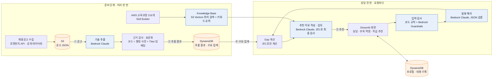
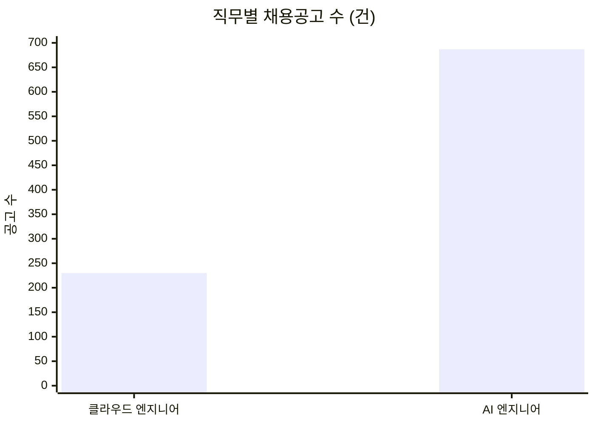
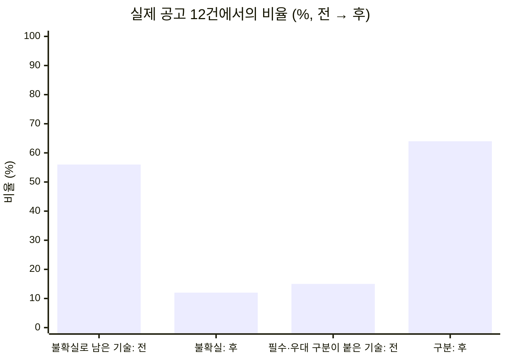
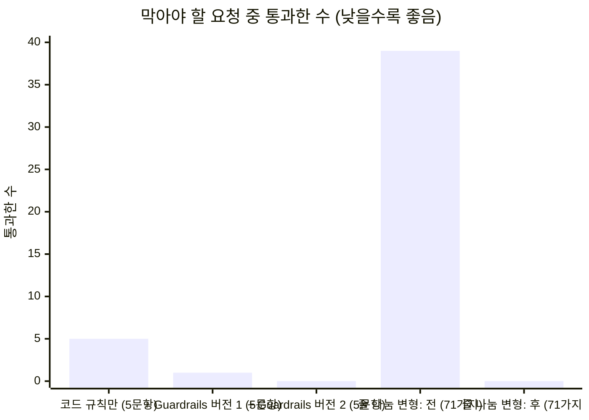
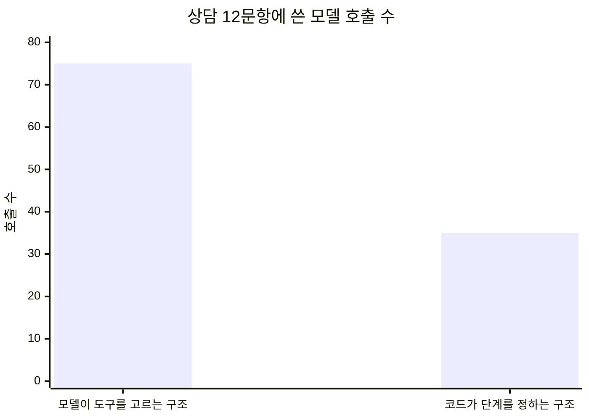
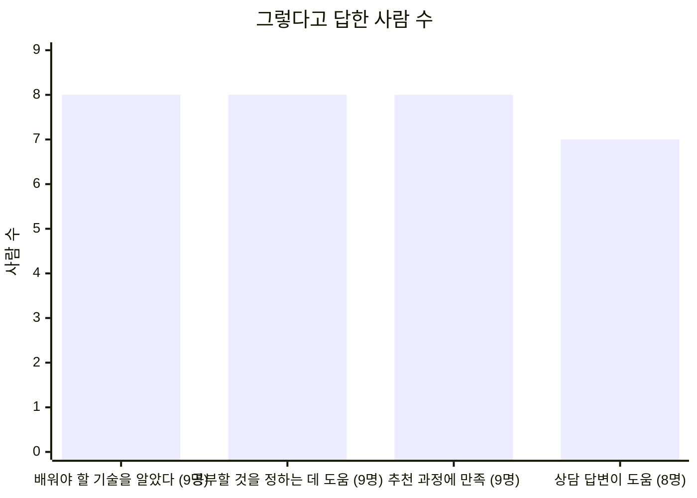

# SkillPath AI

채용공고에서 기술 수요를 근거 문장과 함께 뽑고, 내 보유 기술과 비교해 부족한 역량과 AWS 교육과정을 추천 이유와 함께 보여주는 AI 에이전트입니다.

AI Bootcamp Innovation Challenger 2026 · 팀 ASAP하게

> 이 저장소는 팀 개발 저장소(비공개)에서 공개할 수 있는 파일만 자동으로 옮긴 사본입니다. 개발 중이라 내용이 계속 바뀝니다.
> 최종 동기화: {{SYNC_INFO}}

## 어떤 문제를 푸나

클라우드·AI 엔지니어를 준비하는 취업 준비생은 "공고가 실제로 무엇을 요구하는지"와 "그래서 무엇부터 공부해야 하는지"를 한눈에 보기 어렵습니다.
SkillPath AI는 실제 채용공고를 분석해 세 가지 질문에 답합니다.

1. 어떤 데이터를 분석했나: 실제 공고 몇 건에서 어떤 기술이 몇 번 요구됐는지
2. 어떤 근거로 필요하다고 판단했나: 기술마다 공고 원문의 근거 문장
3. 왜 이 과정을 추천했나: 부족한 기술마다 AWS 교육과정과 추천 이유

## 사용 흐름

1. 학습 상담(첫 화면)에서 해 본 일을 채팅으로 말합니다. 세부 기술별 5단계로 수준을 진단합니다.
2. 부족 역량 화면에서 공고가 요구한 수준과 내 단계를 비교해 먼저 채울 기술을 봅니다. 근거 문장은 시장 수요 화면에서 봅니다.
3. 학습 추천 화면에서 부족한 기술마다 AWS 교육과정 카드를 추천 이유, 소요 시간, 들을 순서와 함께 봅니다.

로그인 없이 모든 화면을 쓸 수 있고, 가입하면 프로필과 대화 기록을 저장합니다.

## 시스템 구조



파랑은 Amazon Bedrock을 부르는 단계, 주황은 저장소, 색이 없는 칸은 코드가 하는 일과 데이터 원천입니다. ①~④는 [`contracts/`](contracts/README.md)의 JSON 형식 번호입니다.

| 폴더 | 내용 |
| --- | --- |
| `app/` | Streamlit 화면 |
| `backend/` | DynamoDB, 수요 집계와 Gap 계산, 상담 요청 처리와 프로필 저장 |
| `pipeline/` | 데이터 수집, 전처리, 별칭 사전, 교육과정 검색 |
| `ai/` | 공고 추출, 상담 발화 해석, 입력 가드레일, 추천 이유 작성·검토, 평가 |
| `contracts/` | 구간 사이를 오가는 JSON 형식 |
| `data/sample/` | 개발용 가짜 데이터 |

화면 순서는 [`docs/service-flow.md`](docs/service-flow.md)에 그림으로 있습니다.

## AWS 서비스와 쓰는 이유

| 서비스 | 어디에 | 왜 |
| --- | --- | --- |
| Amazon Bedrock (Claude) | 기술 추출, 상담 발화 해석, 추천 이유 작성·검토 | 표현이 일정하지 않은 문장을 읽고 설명하는 일 |
| Bedrock Guardrails | 상담 입력 검사 | 차별 판단 요청과 주제 밖 질문을 모델 앞에서 차단. 검사에 실패하면 통과시키지 않음 |
| Titan Embeddings | 표현 표준화 | 같은 뜻의 다른 표현을 의미로 묶기 |
| Bedrock Knowledge Base (S3 Vectors) | 교육과정 검색 | 부족 기술에 맞는 과정을 의미로 찾기. 저장하고 질의한 만큼만 과금 |
| DynamoDB | 추출 결과, 수요 집계, 프로필, 대화 기록 | 닉네임별 조회. 대화 기록은 기본 30일 뒤 자동 삭제 |
| S3 | 수집한 공고 JSON, 교육과정 문서 | 근거 검사, 프롬프트 재실행, 정확도 측정에 같은 데이터 사용 |

API Gateway와 Bedrock Agents는 쓰지 않습니다. 화면이 백엔드 함수를 직접 부르고, 상담에서 어떤 단계를 실행할지는 코드가 정합니다.

## 분석한 데이터

| 데이터 | 건수 | 출처 |
| --- | --- | --- |
| 클라우드 엔지니어 채용공고 | 230건 | 로켓펀치 Open API 18건 + 공개 데이터셋의 원티드 공고 212건 |
| AI 엔지니어 채용공고 | 687건 | 로켓펀치 Open API 71건 + 공개 데이터셋의 원티드 공고 616건 |
| AWS 교육과정 | 216개 | AWS Skill Builder 과정 상세 페이지 |



수집 방법과 한계는 [`docs/data-sources.md`](docs/data-sources.md)에 있습니다. 직무 판정은 모델이 했고 사람이 전부 확인하지는 않았습니다.

## 실험 결과

숫자는 모두 [`ai/eval/IMPROVEMENT_LOG.md`](ai/eval/IMPROVEMENT_LOG.md)에 조건과 함께 적은 값입니다.

### 기술 추출

별칭 사전을 늘리고 추출 프롬프트를 고친 전과 후입니다.



| 지표 | 전 | 후 | 조건 |
| --- | --- | --- | --- |
| 추출 F1 | 0.900 | 0.977 | 가짜 공고 10건, 정답 44개, 3회 같음 |
| "불확실"로 남은 기술 비율 | 56% | 12% | 실제 공고 12건, 1회 |
| 필수·우대 구분이 붙은 비율 | 15% | 64% | 실제 공고 12건, 1회 |

F1은 프롬프트를 고칠 때 본 개선용 데이터의 점수라 높게 나옵니다. 처음 보는 공고 10건은 아직 채점하지 않았습니다.

### 가드레일

코드 규칙과 Bedrock Guardrails를 겹쳐 씁니다.



- 규칙을 고칠 때 보지 않은 5문항 기준으로, 코드 규칙만 쓰면 5개를 모두 놓치고 Guardrails 버전 2를 더하면 0개입니다. 정상 5문항은 어느 설정에서도 막지 않았습니다.
- 한 줄이면 막히는 요청을 두 줄로 나눠 쓴 71가지 중 39가지가 통과하던 것을 0가지로 줄였습니다.
- 한 줄짜리 정상 질문 12개 중 잘못 막는 수는 12개에서 4개로 줄었고, 남은 4개는 과제입니다.
- 문항은 직접 만들었고 각 1회 측정이라 실제 입력에서는 다를 수 있습니다.

### 비용과 속도



| 지표 | 전 | 후 | 조건 |
| --- | --- | --- | --- |
| 추천 화면을 그릴 때 Bedrock 호출 | 6번 | 3번, 다시 그리면 0번 | 상위 3개만 추천하고 결과를 캐시. 1회 |
| 표기가 애매한 질문의 응답 시간 | 46.2초 | 9.8초 | 임베딩 캐시 전과 후, 1회씩 |
| 상담 12문항의 모델 호출과 토큰 | 75번, 183,890토큰 | 35번, 71,639토큰 | 개발용 12문항, 실제 모드 1회. 지금 화면은 뒤쪽 구조 |

### 사용자 테스트

2026-11-20에 온라인 설문으로 9명이 써 보고 답했습니다. 표본이 작아 경향으로만 봅니다.



가장 많이 나온 불만은 "추천 과정의 정보가 부족하다"(5명)와 "응답이 느리다"(3명)였습니다. 과정 카드에 소요 시간, 강의 언어, 다루는 AWS 서비스를 더했고, 응답 속도는 남은 과제입니다.

## 설계 원칙

- **세기는 코드, 이해는 AI.** 빈도, 비율, Gap은 코드로 계산합니다. LLM은 문장 이해와 설명에만 씁니다.
- **근거 없는 결과는 내보내지 않습니다.** 추출한 기술마다 근거 문장이 있고, 그 문장이 공고 원문에 실제로 있는지 코드로 검사합니다.
- **확신이 없으면 "불확실"로 표시합니다.** 그럴듯하게 채우지 않습니다.
- **구간 사이 데이터는 정해진 JSON 형식만 씁니다.** 형식은 [`contracts/`](contracts/README.md)에 있습니다.

## 무엇을 어디서 보나

| 보고 싶은 것 | 위치 |
| --- | --- |
| 문제를 어떤 단계로 풀었나 | [`docs/service-flow.md`](docs/service-flow.md), [`contracts/`](contracts/README.md) |
| 추출 프롬프트와 근거 검증, 정확도 채점 | [`ai/`](ai/README.md) |
| 어떤 데이터를 썼고 한계는 무엇인가 | [`docs/data-sources.md`](docs/data-sources.md) |
| 팀이 어떻게 역할을 나누고 협업했나 | [`COLLABORATION.md`](COLLABORATION.md) |
| 회의에서 무엇을 결정했나 | [`docs/meeting-decisions.md`](docs/meeting-decisions.md) |

## 실행

```bash
python -m venv .venv
source .venv/bin/activate        # Windows: .venv\Scripts\activate
pip install -r requirements.txt
cp .env.example .env
BEDROCK_MOCK=1 streamlit run app/main.py
```

`BEDROCK_MOCK=1`이면 AWS 계정 없이 `data/sample/`의 가짜 데이터로 화면이 뜹니다.
