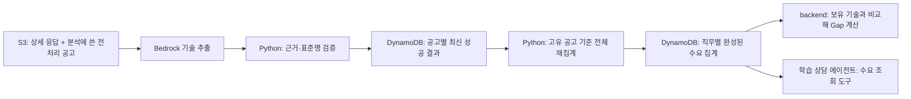

# 채용공고 추출 결과와 수요 집계의 DynamoDB 설계

설계일: 2026-11-15. 제안 단계이며 테이블 생성이나 추출·집계 코드 변경은 포함하지 않는다.
현재 단일 직무, 수십~수백 건 규모의 배치를 기준으로 한다.
MVP에 필요한 최소 구성을 적었고, 뒤로 미룬 장치는 10절에 모았다.

## 1. 저장 구조와 책임



| 저장소 | 역할 |
| --- | --- |
| 기존 S3 | 목록·상세 API 원본, 분석에 사용한 전처리 공고를 불변 키로 보존 |
| `skillpath-posting-extractions` | 공고별 최신 성공 추출, 대표 근거, 분석 입력과 버전 |
| `skillpath-demand` | 화면, Gap 계산, 에이전트 도구가 읽을 직무별 수요 집계 |

추출 결과는 사실의 기준이고 수요 집계는 다시 만들 수 있는 파생 데이터다.
추출은 모델 호출 비용이 들고 실행마다 결과가 달라질 수 있다. 결과를 저장해 두고 다시 집계할 때는 모델을 부르지 않는다.
현재 규모에서는 저장할 때 기술별 카운터를 `ADD +1` 하지 않고, 배치가 끝나면 전체를 다시 센다.
재시도·재추출·공고 제외 때 카운터를 차감하거나 중복 증가를 되돌리는 로직을 줄일 수 있다.

사용자별 보유 기술과 Gap은 이 두 테이블에 저장하지 않는다. 같은 수요 집계를 읽고 사용자 입력에 맞춰 코드로 계산한다.
교육 공급 데이터는 수요와 다른 모집단이며, 시장 Gap에 필요한 공급 집계는 별도로 관리한다.
교육과정 검색도 이 두 테이블을 읽지 않는다. S3의 과정 문서를 Knowledge Base로 검색(RAG)하고,
수요 수치는 집계 테이블에서 조회해 그대로 전달한다(7절).

## 2. 테이블 정의

두 테이블 모두 서울 리전 `ap-northeast-2`, 온디맨드(`PAY_PER_REQUEST`)를 제안한다.
첫 구현에는 GSI, LSI, Streams, TTL을 두지 않는다.

| 테이블 | Partition key | Sort key | 항목 단위 |
| --- | --- | --- | --- |
| `skillpath-posting-extractions` | `job_category` (String) | `posting_id` (String) | 직무·공고별 최신 성공 결과 1개 |
| `skillpath-demand` | `job_category` (String) | 없음 | 직무별 현재 수요 스냅샷 1개 |

테이블 이름은 논리 이름이다. 구현에서는 환경 설정으로 주입하고 실제 계정·리소스 식별자는 코드에 넣지 않는다.
`job_category`는 서비스 직무 코드(현재 `cloud_engineer`)다. 로켓펀치 직군 코드 `dev`와는 다르다.
공고 ID는 `rp-155106`처럼 출처 접두어를 포함한다. 같은 공고가 여러 검색 목록에 있어도 같은 키를 쓴다.

### 직무를 정하는 방법

직무는 모델이 공고에서 추출하지 않는다. 수집·선정 단계에서 지정하고 모든 추출 항목의 partition key로 기록한다.
직무별 수요는 `job_category` 하나로 Query한 공고를 세어 만든다.

- 공고의 직무는 ①의 `role`에 있다(수집기의 `--role` 값).
- 배치는 직무 코드 하나를 받아 실행한다. 대상 공고의 `role`을 대응표로 직무 코드로 바꾼 값이 실행한 직무와 같아야 한다.
  다르거나 대응표에 없으면 저장하지 않고 오류를 보고한다.
- 직무 코드, 화면에 보여줄 이름(`demand.job_title`), `role` 값의 대응표는 한 곳에 둔다. 현재는 `app/main.py`의 `JOBS`에만 있다.
  집계 코드는 화면 코드를 불러오지 않으므로 대응표를 `backend/`나 `data/`로 옮기고 화면이 그것을 읽게 한다.
- 로켓펀치 상세 응답의 `jobCategory`는 현재 수집한 공고 전부가 `dev`여서 직무를 구분하지 못한다.
- 직무에 맞지 않는 공고는 선정 규칙으로 거른다(4절). 모델로 직무를 분류하는 방식은 ② 계약 변경이 필요하고,
  분류가 바뀌면 키가 달라져 항목을 지우고 다시 써야 하므로 쓰지 않는다.

직무 하나를 한 partition key에 모으는 선택은 현재 규모에 맞춘 것이다.
트래픽·공고 수가 크게 증가하면 접근 패턴과 부하를 측정한 뒤 키 분산과 인덱스를 재검토한다.

## 3. 공고별 추출 결과: skillpath-posting-extractions

| 속성 | 타입 | 의미 |
| --- | --- | --- |
| `job_category`, `posting_id` | String | 기본 키 |
| `source` | String | `rocketpunch` 등 출처. 집계의 `sources`를 만드는 데 쓴다 |
| `posting_meta` | Map | 제목, 회사명, 원본 URL, 게시일. 본문 전체는 넣지 않음 |
| `extraction` | Map | 기존 ② 형식 그대로: `posting_id`, `skills[]` |
| `posting_s3_key` | String | 실제 분석한 전처리 공고의 S3 객체 키. 키에 내용의 SHA-256이 들어 있어 내용 버전까지 가리킨다 |
| `posting_text_sha256` | String | 모델에 넣고 근거 검사에 사용한 `posting.text`의 UTF-8 해시 |
| `analysis` | Map | 모델 ID, 프롬프트·추출기 버전, 표준명 목록 해시, 추론 설정, 분석 시각, 토큰 사용량 |
| `input_fingerprint` | String | 동일 입력·설정 재처리를 식별하는 해시 |

버킷 이름은 환경 설정에서 읽고 항목에 넣지 않는다.

이 테이블의 결과 항목은 성공한 결과만 기록한다. 실패한 시도가 기존 성공 결과를 빈 `skills`로 덮으면 안 된다.
미처리·실패는 배치 실행 기록(6절)에 남기고 다음 실행에서 같은 입력으로 다시 시도한다.
이전 성공 결과의 입력 해시가 이번 배치의 선택된 입력과 다르면 이번 배치의 성공 건수로 인정하지 않는다.

아래 예시는 가상 데이터이며 실제 추출 결과가 아니다. JSON은 boto3 resource에 전달하는 문서 형태다.
`{"S": ...}` 같은 low-level DynamoDB AttributeValue 표기와는 구분한다.

```json
{
  "job_category": "cloud_engineer",
  "posting_id": "rp-000001",
  "source": "rocketpunch",
  "posting_meta": {
    "title": "클라우드 엔지니어",
    "company": "가상회사",
    "url": "https://example.com/jobs/000001",
    "posted_at": "2026-11-15"
  },
  "extraction": {
    "posting_id": "rp-000001",
    "skills": [
      {
        "raw": "도커",
        "normalized": "Docker",
        "type": "required",
        "evidence": "도커 컨테이너 운영 경험이 필요합니다.",
        "confidence": "high",
        "ncs_unit": null
      }
    ]
  },
  "posting_s3_key": "skillpath/rocketpunch/processed/postings/rp-000001/<posting-sha256>.json",
  "posting_text_sha256": "<text-sha256>",
  "analysis": {
    "model_id": "<BEDROCK_MODEL_ID>",
    "prompt_version": "<extract-prompt-version>",
    "extractor_version": "<extractor-version>",
    "canonical_skills_sha256": "<canonical-skills-sha256>",
    "inference_config": {"temperature": "0.0", "max_tokens": 4096},
    "extracted_at": "2026-11-15T03:00:00Z",
    "usage": {"inputTokens": 500, "outputTokens": 200, "totalTokens": 700}
  },
  "input_fingerprint": "<input-and-settings-sha256>"
}
```

`input_fingerprint`는 직무·공고 ID, 분석 본문, 프롬프트, 모델, 추론 설정, 추출기·표준명 목록 버전을
키 순서가 고정된 JSON으로 표현해 SHA-256을 계산한다. 같은 입력·설정으로 재시도하면 기존 성공 결과를 재사용한다.
프롬프트, 표준명 목록, 추출 후처리 코드가 바뀌면 fingerprint가 달라져 다음 배치에서 다시 추출된다.

- 비교할 때는 현재 입력·설정으로 계산한 값을 저장된 문자열과 비교한다.
  저장된 항목의 `analysis`로 다시 계산하지 않는다. 읽은 숫자는 `Decimal`이라 같은 입력도 다른 해시가 될 수 있다(7절).
- `extractor_version`은 추출 후처리 코드(`to_contract()`)를 바꿀 때 올리는 상수다. 현재 코드에 없으므로 추가한다.
- `canonical_skills_sha256`은 `high` 판정에 실제로 쓰는 표준명 목록의 해시다.
  현재는 `ai/prompts/extract_v1.py`의 `CANONICAL_SKILLS`다(8절).
- 같은 fingerprint인데도 다시 추출하려면 강제 옵션으로 실행해 현재 결과를 교체한다. 이전 결과는 남지 않는다.

상세 API 원본은 HTML 태그 등을 포함하고 전처리 공고 본문과 다르다.
그래서 상세 원본이 아니라 실제 분석한 전처리 공고의 키와 `posting.text` 해시를 남긴다.
상세 원본은 같은 공고 ID의 `raw/details/` 경로에서 찾는다.
기술의 `raw`는 공고 표현이고 모델 응답 원문을 뜻하지 않는다.
선택되지 않은 후보를 포함한 전체 모델 출력은 보관하지 않는다(10절).

항목이 400KB 제한을 넘으면 DynamoDB가 `PutItem`을 거부하고 아무것도 쓰지 않는다.
이 오류를 잡아 저장 실패로 보고하며 크기를 미리 계산하지 않는다. 400KB에는 속성 값뿐 아니라 속성 이름의 길이도 포함된다.
근거를 몰래 자르거나 일부 기술만 저장해 정상 집계로 취급하지 않는다.
[DynamoDB 항목 크기 제한](https://docs.aws.amazon.com/amazondynamodb/latest/developerguide/Constraints.html#limits-items)

## 4. 집계 규칙

### 분석 대상 선정

- 분석 대상은 수집기가 현재 통과시킨 전처리 공고(`data/raw/rp-*.posting.json`)다. 배치를 시작할 때 이 목록을 대상으로 고정한다.
- 상세 응답이 S3에 있다는 사실만으로 분석 대상에 포함하지 않는다. 현재 수집기의 후보 상세와 필터 통과 공고를 구분한다.
- S3의 `processed/postings/`를 나열해 대상을 정하지 않는다. 수집기는 필터에서 탈락한 공고의 로컬 통과본을 지우지만
  S3에 올라간 예전 통과본은 지우지 않는다. 내용이 바뀐 공고는 예전 버전도 S3에 남는다.
- 대상 공고마다 `pipeline.storage.object_key()`로 S3 키를 계산하고, 객체가 없으면 올린 뒤 그 키에서 전처리 공고를 읽어 분석한다.
  로컬 파일을 직접 분석하지 않으므로 로컬 실행과 Lambda 실행이 같은 입력을 읽는다.
- 선정 규칙은 코드로 적용하고 모델을 쓰지 않는다. 현재 규칙은 본문의 `aws` 포함 여부뿐이어서 직무가 먼 공고가 섞인다
  (`docs/data-sources.md`). 규칙을 바꾸면 규칙 이름을 올리고 집계의 `policy.selection_version`에 기록한다.
- 추출이 반복해서 실패하는 공고는 실행 인자로 제외를 지정한다. 제외한 공고는 분모에 넣지 않고
  `quality.excluded_postings`에 공고 ID와 사유를 남긴다. 지정 없이 실패한 공고를 건너뛰고 공개하지 않는다.

### 모집단과 분모

- `total_postings`는 해당 스냅샷에서 분석 대상으로 채택하고 추출에 성공한 **고유 공고 수**다.
  집계 항목의 `counted_postings` 개수와 같다.
- 기술이 0개이거나 `uncertain`만 있는 정상 분석 공고도 분모에 포함한다.
- 검색 키워드가 다르거나 원본 내용 버전이 여러 개여도 공고당 선택된 결과 하나만 사용한다.
- 이번 집계에서 센 공고의 ID와 fingerprint는 집계 항목의 `counted_postings`에 넣는다.

### 기술별 수요

후보를 고르는 일은 추출 결과를 저장하기 전에 끝내고, 집계는 저장된 결과를 세기만 한다.

**추출 결과를 저장하기 전 (`ai/extract.py`의 `to_contract()`)**

1. 근거 문장이 공고 본문에 있는지, 표준명이 표준명 목록에 있는지 코드로 검사한다.
   `high`는 확률이 아니라 이 규칙 검사를 통과했다는 뜻이다.
2. 같은 표준 기술명의 후보가 여럿이면 검사를 통과한 후보를 먼저 고른다.
3. 통과한 후보 중 `required`가 있으면 `required`, 없으면 `preferred`를 남긴다.
   통과한 후보가 없으면 `uncertain` 후보 하나를 남긴다.

**집계할 때 (`backend/`)**

4. 저장된 `extraction.skills`에서 `confidence`가 `high`인 기술만 센다.
   해당 기술의 `postings`에 1, 그 기술의 `type` 건수에만 1을 더한다.
5. `uncertain`은 보존하지만 확정 수요에서는 제외한다. 기술별 불확실 공고 수는 별도 품질 지표로 기록한다.
6. 대표 근거는 기술별 최대 3개를 결정적인 순서로 선택하고 공고 ID·원본 URL과 함께 넣는다.

집계는 근거를 다시 검사하지 않는다. 공고 본문은 DynamoDB에 없고,
저장된 `confidence`는 본문 해시와 표준명 목록 해시가 들어간 fingerprint로 현재 입력에 묶여 있다.
fingerprint가 이번 배치의 입력과 다른 항목은 세지 않으므로 본문이나 표준명 목록이 바뀌기 전의 판정이 집계에 들어가지 않는다.

현재 2단 구분에서는 `postings = required + preferred`가 성립해야 한다.
같은 기술이 한 공고에 5번 나와도 수요는 1건이다. `uncertain` 수는 기술별 고유 공고 수이며 확정 수요와 합쳐 분자를 만들지 않는다.

### 영역·세부 능력

영역별 수요는 집계 항목에 저장하지 않는다.
`get_area_gap()`이 `demand.skills`와 현재 `data/skill_areas.json`으로 읽을 때마다 계산한다.
이 값은 영역 안 기술별 요구 공고 수의 합이다. 예를 들어 AWS는 현재 `COMMON`이고 Linux·Docker·Kubernetes는 `C1`이며,
같은 공고에 Linux와 Docker가 있으면 C1에 2건으로 센다.

영역의 기술을 하나 이상 요구한 고유 공고 수(위 예에서는 C1에 1건)는 기술별 건수로 계산할 수 없다.
화면에 필요해지면 집계 단계에서 따로 세고 ④ 계약에 필드를 추가한다(인터페이스 변경). 두 값을 서로 대체하지 않는다.
사전에 없는 기술은 미분류로 둔다. 영역 매핑만으로 NCS나 세부 능력 매핑이 끝났다고 취급하지 않는다.
현재 `ncs_unit`은 항상 `null`이다. 세부 능력 사전이 확정되면 집계 방식을 따로 정한다.

## 5. 직무별 수요 집계: skillpath-demand

한 직무의 집계 전체를 한 항목에 저장하고 한 번에 교체한다.
기술별 개별 카운터 항목으로 쪼개지 않아 전체 공고 수와 기술별 건수가 서로 다른 시점의 값으로 읽히는 일을 피한다.
집계 항목이 400KB를 넘으면 DynamoDB가 `PutItem`을 거부하므로 이전 스냅샷이 그대로 남는다. 이 오류를 잡아 보고한다.

| 속성 | 의미 |
| --- | --- |
| `job_category` | 기본 키 |
| `snapshot_id`, `generated_at` | 집계 식별자, 생성 시각 |
| `demand` | 기존 ④ 수요 집계 계약 그대로 |
| `counted_postings` | 이번 집계에서 센 공고의 ID와 fingerprint 목록. 공고 한 건에 약 100바이트라 수백 건이어도 수십 KB다 |
| `quality` | 선정 규칙을 통과한 공고 수, 제외한 공고와 사유, 빈 추출·불확실만 있는 공고 수, 기술별 불확실 공고 수 |
| `policy` | 선정·집계 규칙 버전과 포함할 확신도 기준 |

`demand`의 필드는 다음과 같이 채운다.

| `demand` 필드 | 채우는 방법 |
| --- | --- |
| `job_category`, `job_title` | 배치를 실행한 직무 코드와 대응표의 이름(2절) |
| `total_postings` | `counted_postings`의 개수 |
| `sources` | 센 공고의 `source` 값을 중복 없이 정렬 |
| `collected` | 배치 실행 인자로 받는다. ①에는 수집일 필드가 없으므로 `docs/data-sources.md`에 적은 수집일(또는 기간)과 같은 값을 넣는다 |
| `skills[]` | 4절의 규칙으로 계산 |

아래 집계 수치는 구조 설명용 가짜 값이다. `counted_postings`는 2건만 적었고 실제로는 `total_postings`와 같은 12건이 들어간다.

```json
{
  "job_category": "cloud_engineer",
  "snapshot_id": "20261115T030000Z-demo",
  "generated_at": "2026-11-15T03:00:00Z",
  "demand": {
    "job_category": "cloud_engineer",
    "job_title": "클라우드 엔지니어",
    "total_postings": 12,
    "sources": ["rocketpunch"],
    "collected": "2026-11-15",
    "skills": [
      {
        "skill": "Docker",
        "postings": 8,
        "required": 5,
        "preferred": 3,
        "evidence_samples": [
          {
            "posting_id": "rp-000001",
            "url": "https://example.com/jobs/000001",
            "evidence": "도커 컨테이너 운영 경험이 필요합니다."
          }
        ]
      },
      {
        "skill": "Linux",
        "postings": 7,
        "required": 6,
        "preferred": 1,
        "evidence_samples": [
          {
            "posting_id": "rp-000002",
            "url": "https://example.com/jobs/000002",
            "evidence": "Linux 서버 운영 경험이 필요합니다."
          }
        ]
      }
    ]
  },
  "counted_postings": [
    {"posting_id": "rp-000001", "input_fingerprint": "<input-and-settings-sha256>"},
    {"posting_id": "rp-000002", "input_fingerprint": "<input-and-settings-sha256>"}
  ],
  "quality": {
    "eligible_postings": 13,
    "excluded_postings": [
      {"posting_id": "rp-000013", "reason": "추출 응답 형식 검사 2회 실패"}
    ],
    "empty_extraction_postings": 1,
    "uncertain_only_postings": 1,
    "uncertain_skills": [{"skill": "Terraform", "postings": 1}]
  },
  "policy": {
    "selection_version": "cloud-aws-v1",
    "aggregation_version": "demand-v1",
    "count_confidence": "high"
  }
}
```

`eligible_postings`는 `total_postings`에 제외한 공고 수를 더한 값이다. 위 예시는 13 = 12 + 1이다.

비율은 저장하지 않고 건수에서 계산한다. Docker의 요구 비율은 8/12, 필수 비율은 5/8이다.
개인 Gap은 요구 비율이 기준 이상(현재 20%)이면서 사용자가 보유하지 않은 기술을 고른다.
시장 Gap은 이 건수에 가중치를 적용해 별도의 교육 공급 집계와 비교한다. 가중 합을 `postings`에 섞지 않는다.

## 6. 저장·재집계·공개 순서

### 실행 방식

- 배치는 사람이 수동으로 시작한다. 로컬에서 실행하거나, 로컬에서 만든 대상 목록(공고 ID와 S3 키)을 입력으로 받는 Lambda를 수동으로 호출한다.
- S3에 객체가 올라올 때마다 Lambda를 실행하는 방식은 쓰지 않는다.
  공고마다 실행이 따로 돌면 아래의 "직무별 배치 하나" 전제가 깨지고 집계 시점을 정할 수 없다.
- Lambda 한 번의 실행은 최대 15분이다. 대상이 많아 한 번에 끝나지 않으면 다시 호출한다.
  같은 fingerprint의 결과는 재사용하므로 남은 공고부터 이어진다.
- 가짜 모드(`BEDROCK_MOCK=1`)에서는 두 테이블에 쓰지 않고 중단한다. `BEDROCK_MOCK`은 설정하지 않으면 `1`이고
  가짜 응답의 기본값은 기술 0건이다. 그대로 저장하면 모든 공고가 기술 0건의 성공으로 기록되어 빈 집계가 공개된다.
- S3 버킷이나 테이블 이름이 설정되지 않았으면 시작하지 않는다.
  수집기는 버킷 설정이 없으면 로컬에만 저장하므로 S3 키가 가리키는 객체가 없을 수 있다.

### 순서

1. **대상을 고정한다.** 4절의 선정 규칙으로 대상 공고를 정하고, 공고마다 S3 키와 fingerprint를 계산한다.
   제외로 지정한 공고는 뺀다.
2. **추출·검증한다.** 같은 fingerprint의 성공 결과가 있으면 재사용하고, 없으면 S3의 전처리 공고를 읽어 추출한다.
3. **현재 결과를 저장한다.** 성공한 결과만 `PutItem`으로 같은 키의 항목을 교체한다.
4. **전체를 재집계한다.** 해당 직무의 결과를 Query하고, 1단계 목록의 공고 ID·fingerprint와 일치하는 항목만 사용한다.
5. **완료 여부를 확인한다.** 대상 중 일치하는 성공 결과가 없는 공고가 하나라도 있으면 새 집계를 공개하지 않고 이전 스냅샷을 유지한다.
   기술 0건의 정상 결과는 실패가 아니다.
6. **완성 결과를 공개한다.** `skillpath-demand`의 한 항목을 `PutItem`으로 교체한다.
   항목 하나의 교체는 한 번에 이루어지므로 읽는 쪽이 이전 집계와 새 집계가 섞인 상태를 보는 일은 없다.
   중간 실패로 이전 완성 결과를 지우거나 작성 중인 부분 집계를 화면에 노출하지 않는다.
7. **실행 기록을 남긴다.** 공개 여부와 관계없이 요약 한 건을 남긴다.

배치 실행 기록은 실행 ID, 대상·성공·재사용·실패·제외 수, 실패한 공고 ID와 오류 종류,
실패한 호출을 포함한 토큰 합계를 담은 JSON 한 줄이다.
로컬 실행은 표준 출력, Lambda는 CloudWatch 로그에 남긴다. 별도 테이블이나 S3 객체는 만들지 않는다.

MVP에서는 **직무별 배치를 하나만 실행하고, 추출 결과 갱신 중에 별도의 집계를 실행하지 않는다.**
각 Query를 `ConsistentRead=true`로 읽더라도 여러 페이지·항목 전체가 한 시점의 스냅샷이 되는 것은 아니다.
두 배치가 동시에 돌지 않는다는 전제이므로 버전 속성과 조건부 갱신은 두지 않는다.
병렬 작업자나 이벤트 기반 처리를 도입할 때는 세대를 고정하거나 배타 제어를 추가 설계한다(10절).

DynamoDB에는 같은 공고의 현재 결과 하나만 둔다.
대상에서 빠진 공고나 예전 입력의 결과가 테이블에 남아 있어도 4단계에서 세지 않는다.
집계할 때 같은 공고의 여러 결과를 별도 공고로 세지 않는다.

## 7. 조회 패턴

| 조회 목적 | 연산 |
| --- | --- |
| 공고 한 건의 추출 결과·근거 확인 | 추출 테이블의 GetItem(`job_category`, `posting_id`) |
| 직무별 결과 수집과 재집계 | 추출 테이블의 Query(`job_category`)를 모든 페이지에서 조회 |
| 기술 순위·Gap용 집계 조회 | 집계 테이블의 GetItem(`job_category`)에서 `demand` 반환 |
| 기술의 대표 근거 표시 | `demand.skills[].evidence_samples` 조회 |
| 에이전트의 수요 조회 도구 | 집계 테이블의 GetItem(`job_category`) 뒤 근거 문장을 뺀 요약만 반환 |
| 특정 기술을 요구하는 공고 전체 확인 | 직무별 Query 결과 중 `counted_postings`에 있는 항목만 Python으로 필터링 |

[Query는 partition key를 지정한다](https://docs.aws.amazon.com/amazondynamodb/latest/developerguide/Query.html).
전체 테이블 Scan 대신 최대 1MB 단위로 페이지를 읽고, `LastEvaluatedKey`가 없어질 때까지 계속한다.
`FilterExpression`은 읽은 뒤 적용하는 조건이며 기술별 검색을 빠르게 하는 인덱스가 아니다.
`skills` 목록의 각 요소에 일반 GSI를 직접 설정해 역조회할 수는 없다.
기술별 대량 역조회가 필요해지면 `기술 × 공고` 관계 항목과 인덱스를 검토한다.

### 읽은 값의 변환

boto3 resource는 숫자를 정수여도 `Decimal`로 돌려준다.
`get_demand()`는 읽은 직후 건수를 `int`로 바꿔 ④ 형식 그대로 돌려준다.
바꾸지 않으면 `get_market_gap()`의 가중치 곱셈, 화면의 영역별 차트 축 계산, `json.dumps()`가 `TypeError`로 실패한다.

### 한 번의 화면 렌더링

`backend/api.py`의 Gap·추천 함수는 각자 `get_demand()`를 부르므로 화면을 한 번 그릴 때 집계를 최대 6번 읽는다.
`get_demand()`에 짧은 캐시(예: 60초)를 두어 한 번의 렌더링이 같은 `snapshot_id`의 집계로 비율·Gap·추천 입력을 만들게 한다.
새 집계는 캐시 시간이 지난 뒤 화면에 반영된다.
갱신 직후 반영이 필요한 조회는 기본 테이블의 `ConsistentRead=true`를 사용한다.

### 에이전트와 교육과정 추천

- 에이전트의 수요 조회 도구는 전체 공고 수, 수집일, 기술별 건수(전체·필수·우대)만 JSON으로 돌려준다.
  근거 문장과 공고 링크는 넣지 않는다. 근거 문장은 추출 단계의 확인에만 쓰고 추천 단계에서는 참고하지 않는다.
- 수요 수치는 검색(RAG)으로 가져오지 않는다. Bedrock Knowledge Base의 데이터 소스에 DynamoDB는 없고,
  수치는 계산된 값을 그대로 전달해야 한다.
- RAG는 교육과정 검색에 쓴다. S3의 과정 문서를 Knowledge Base가 읽는다.
- 순서는 수요 집계 조회 → 코드로 Gap 계산 → 부족 기술로 과정 검색 → 수치와 검색된 과정으로 추천 이유 생성이다.

## 8. 현재 코드와 연결할 때의 주의점

- 저장에는 `extract_with_meta()`를 쓴다. `ConverseResult.usage`를 `analysis.usage`에 넣기 위해서다.
  실패한 호출의 토큰은 `BedrockJSONError.usage`에 있으므로 배치 실행 기록의 합계에 더한다.
- 현재 `to_contract()`는 검증 확신도보다 `required`를 우선하므로 잘못된 근거의 `required/uncertain`이
  올바른 `preferred/high`를 대체할 수 있다. **유효한 후보를 먼저 선택하도록 보완한 뒤** DB 저장·집계에 연결한다.
  기존 ②의 필드를 변경할 필요는 없다. 보완하면서 `extractor_version` 상수를 추가한다.
- `high` 판정의 표준명 목록은 현재 `CANONICAL_SKILLS` 12개다. `data/aliases.json`(43개), `data/skill_areas.json`(31개)과 다르다.
  영역 사전에만 있는 EC2, S3, IAM, RDS, VPC, Lambda 등 19개 기술은 지금은 항상 `uncertain`이 되어 확정 수요에서 빠진다.
  추출의 기준 목록을 별칭 사전으로 바꾸는 일(#13)을 `ai/`·`pipeline/` 담당과 맞춘다. 목록이 바뀌면 fingerprint가 달라져 다시 추출된다.
- 현재 ②와 추출 프롬프트는 `required`, `preferred`만 지원한다. `duty`는 미지원이며 주요 업무도 `required`에 포함한다.
  3단 구분으로 전환할 때는 추출기, contracts, 예시, 집계를 함께 변경한다.
- `extraction`과 `demand` 내부는 기존 계약을 유지하고 DB용 메타데이터는 외부에 둔다.
  DB 메타데이터를 기존 화면 API에 그대로 반환하지 않는다.
- `get_demand()`의 실제 모드는 집계 테이블의 `demand`를 읽어 숫자를 `int`로 바꾼 뒤 반환하고, 짧은 캐시를 둔다(7절).
  개인 Gap의 기본식은 그대로 사용할 수 있다.
- 직무 코드와 이름의 대응표는 현재 `app/main.py`의 `JOBS`에만 있다. `backend/`나 `data/`로 옮긴다(2절).
- `BEDROCK_MOCK`은 설정하지 않으면 `1`이다. 배치와 Lambda 환경에서 `0`으로 설정했는지 확인하고, 가짜 모드에서는 저장하지 않는다(6절).
- S3 키와 SHA-256은 로컬 파일의 바이트로 계산한다. 수집기는 줄바꿈을 `\n`으로 고정해 저장하므로 OS가 달라도 같은 내용은 같은 키가 된다.
  고정하기 전에 Windows에서 저장한 파일은 CRLF 그대로라 키가 다르다. 전처리 공고는 `fetch`나 `collect`를 다시 실행하면 `\n`으로 다시 저장된다.
  `input_fingerprint`는 본문 문자열로 계산하므로 영향이 없다.
- `source`, `url`, `type`, `raw`, `usage` 등은 DynamoDB 예약어다.
  이런 이름을 조건식·투영식·필터식에 쓸 때는 ExpressionAttributeNames를 사용한다. `demand`, `quality`, `policy`는 예약어가 아니다.
- 기본적으로 정수 건수를 저장한다. boto3는 `float`를 받지 않으므로 설정의 소수 값은 문자열로 보존하고 계산할 때 변환한다.
- 테이블 생성·연결 코드를 추가할 때 테이블명을 읽는 환경변수 이름을 `.env.example`에도 추가한다.

## 9. 구현 시 검증 조건

- 같은 공고·입력을 두 번 처리해도 기술별 공고 수가 늘지 않는다.
- 한 공고에 Docker가 여러 번 나와도 Docker 요구 공고 수는 한 건만 증가한다.
- 한 공고에 Docker와 Linux가 있으면 `get_area_gap()`의 C1 수요는 2 증가한다.
- 잘못된 required가 올바른 preferred를 없애지 않는다. uncertain은 보존하지만 확정 집계에는 넣지 않는다.
- 기술 0건·uncertain만 있는 성공 공고도 분모에 포함한다.
- 재추출이나 대상 제외 후 재집계하면 이전 기술·근거·건수가 현재 집계에서 제거된다.
- 대상에서 빠진 공고의 항목이 테이블에 남아 있어도 집계와 기술별 공고 조회에 섞이지 않는다.
- 입력 변경 후 추출에 실패하면 이전 결과를 이번 성공으로 세지 않고 미완성 집계를 공개하지 않는다.
- 제외로 지정한 공고는 분모에 들어가지 않고 `quality.excluded_postings`에 사유와 함께 남는다.
- 같은 입력·결과 목록으로 재집계하면 같은 건수가 나온다.
- 모든 기술에서 `0 <= required, preferred <= postings <= total_postings`와 `required + preferred = postings`를 만족한다.
- `total_postings`는 `counted_postings`의 개수와 같고, `eligible_postings`는 `total_postings`에 제외한 공고 수를 더한 값이다.
- 서로 다른 기술·영역의 건수를 더해 전체 공고 수로 사용하지 않는다.
- DynamoDB에서 읽은 집계로 `get_gap()`, `get_area_gap()`, `get_market_gap()`, `json.dumps()`가 모두 동작한다.
- 가짜 모드에서 배치를 실행하면 두 테이블에 아무것도 쓰지 않고 중단한다.
- 페이지 처리, DB 저장 실패, 크기 초과 시 잘못된 성공을 반환하지 않는다.
- 같은 공고를 Windows와 다른 OS에서 저장해도 S3 키가 같다.
- 모의 추출과 실제 데이터의 공개 집계를 섞지 않는다. 테스트는 별도 테이블이나 환경에서 실행한다.

## 10. MVP에서 미루는 것

아래 장치는 지금 두지 않아도 집계가 틀리지 않는다. 오른쪽 조건이 생기면 추가한다.

| 미루는 것 | 지금 대신 하는 것 | 필요해지는 조건 |
| --- | --- | --- |
| 추출 이력과 전체 모델 출력의 S3 보관 | 공고별 현재 결과 하나만 DynamoDB에 둔다 | 프롬프트 버전별 결과를 비교하거나 과거 결과를 재현해야 할 때 |
| 집계 입력 목록(manifest)과 공개한 집계의 S3 보관 | 집계 항목의 `counted_postings`. 이전 집계는 남지 않고 필요하면 다시 집계한다 | 과거 스냅샷을 재현해야 할 때, 공고가 늘어 집계 항목이 400KB에 가까워질 때 |
| 버전 속성(`record_version`, `aggregate_version`)과 조건부 갱신 | 직무별 배치를 하나만 수동으로 실행한다 | 병렬 작업자나 이벤트 기반 처리를 도입할 때 |
| 영역별 고유 공고 수 저장 | `get_area_gap()`이 기술별 건수로 계산한다 | 화면이 영역별 고유 공고 수를 보여주기로 할 때(④ 계약 변경) |
| 상세 원본 참조와 공고별 포함 여부 표시 | 전처리 공고의 S3 키, 집계 항목의 `counted_postings` | 같은 공고의 원본 버전을 구분해 추적해야 할 때 |
| 항목 크기 사전 계산 | `PutItem`의 크기 초과 오류를 잡아 보고한다 | 근거가 많아져 초과가 실제로 발생할 때 |

## 참고

- [Query와 페이지 처리](https://docs.aws.amazon.com/amazondynamodb/latest/developerguide/Query.Pagination.html)
- [Query 필터 적용 시점](https://docs.aws.amazon.com/amazondynamodb/latest/developerguide/Query.FilterExpression.html)
- [GSI 키와 속성 제약](https://docs.aws.amazon.com/amazondynamodb/latest/developerguide/GSI.html)
- [읽기 일관성](https://docs.aws.amazon.com/amazondynamodb/latest/developerguide/HowItWorks.ReadConsistency.html)
- [갱신식과 카운터](https://docs.aws.amazon.com/amazondynamodb/latest/developerguide/Expressions.UpdateExpressions.html)
- [트랜잭션과 멱등성](https://docs.aws.amazon.com/amazondynamodb/latest/developerguide/transaction-apis.html)
- [예약어 목록](https://docs.aws.amazon.com/amazondynamodb/latest/developerguide/ReservedWords.html)
- [Knowledge Base 데이터 소스](https://docs.aws.amazon.com/bedrock/latest/userguide/data-source-connectors.html)
