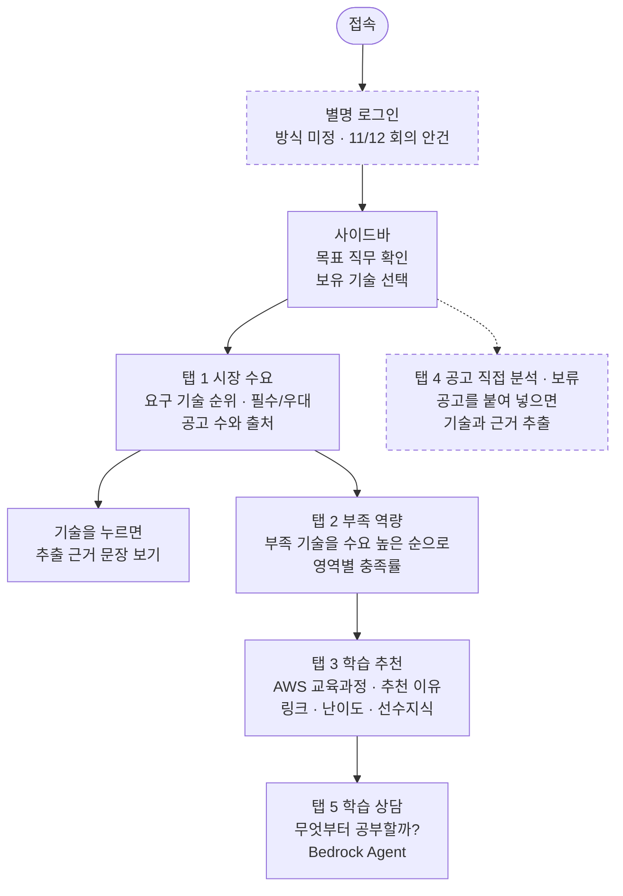
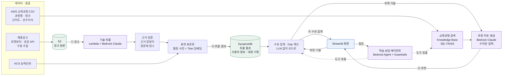

# 서비스 플로우

2026-11-12 기준. 그림은 Mermaid 텍스트라서 GitHub에서 이 파일을 열면 바로 그림으로 보입니다.
고치려면 파일 오른쪽 위 연필 아이콘을 누르고 아래 코드 블록의 글자를 바꾼 뒤 PR을 올립니다.
구조나 JSON 형식이 바뀌는 수정은 [`contracts/`](../contracts/README.md)와 같은 PR에서 함께 고칩니다.

## 1. 사용자 흐름

취업 준비생이 보유 기술을 고르고 추천을 받기까지의 화면 순서입니다.

- 점선 칸은 아직 확정되지 않은 부분입니다. 로그인 방식과 탭 4를 필수로 되돌릴지는 회의에서 정합니다.
- 발표의 세 질문과 화면의 대응: 어떤 데이터를 분석했나 → 탭 1, 어떤 근거로 필요하다 판단했나 → 탭 1의 근거 문장과 탭 2, 왜 이 과정을 추천했나 → 탭 3.
- 근거 문장은 추출 결과에서만 보여줍니다. 추천 화면에는 수요 수치와 추천 이유가 붙습니다(2026-11-12).

## 2. 시스템 구조

공고가 왼쪽에서 들어와 오른쪽 화면에서 추천으로 나옵니다. 화살표의 ①~④는 구간 사이를 오가는 JSON 형식 번호입니다.

| 색 | 뜻 |
| --- | --- |
| 보라 | AI가 하는 일 (Bedrock) |
| 초록 | 저장소 |
| 파랑 | 화면 |
| 색 없음 | 코드가 하는 일, 데이터 원천 |

구간별 담당과 이슈는 [WBS](wbs.md)에, JSON 형식은 [`contracts/`](../contracts/README.md)에 있습니다.

### 구조에서 지키는 것

1. **세기는 코드, 이해는 AI.** 보라색 칸만 Bedrock을 부릅니다. 빈도, 비율, Gap은 집계 코드가 계산하고 추천 이유는 그 숫자를 받아 쓰기만 합니다.
2. **근거 문장은 추출 단계에서만 씁니다.** 추출 직후 근거 문장이 공고 원문에 실제로 있는지 코드로 확인하고, 없으면 버리거나 "불확실"로 표시합니다.
3. **S3에 공고 원본을 저장합니다.** 근거 검증, 프롬프트 재실행, 정확도 측정에 같은 원문이 필요합니다(2026-11-12 확정).
4. **학습 상담 에이전트는 이미 만든 함수를 도구로 부르기만 합니다.** 수요 조회와 과정 검색 두 개이고, Guardrails가 주제 밖 질문을 막습니다.

### 아직 정해지지 않은 것

- 로그인 방식과 DynamoDB에 저장할 사용자 항목
- Gap의 정의: 기술 단위 Gap과 역량 영역별 Gap을 어떻게 계산할지
- API Gateway를 쓸지: 공고 직접 분석 탭을 넣을 때만 쓰자는 안과 빼자는 안이 있습니다
