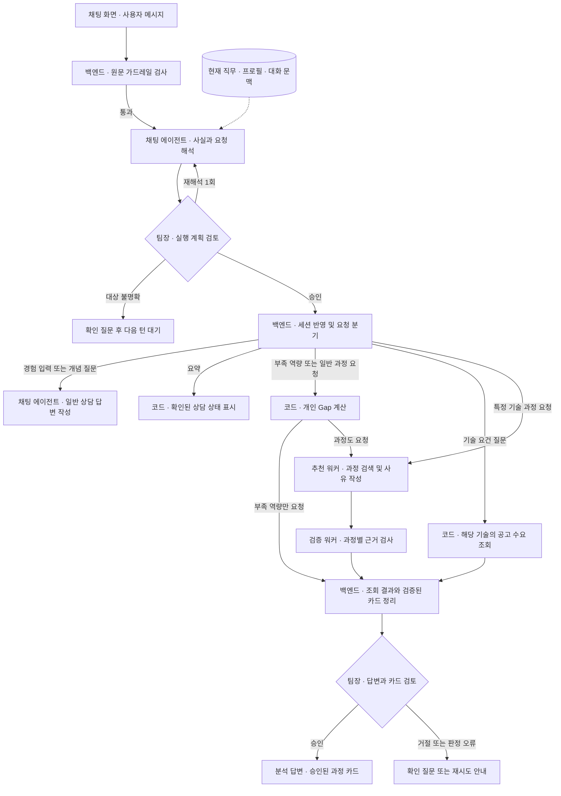
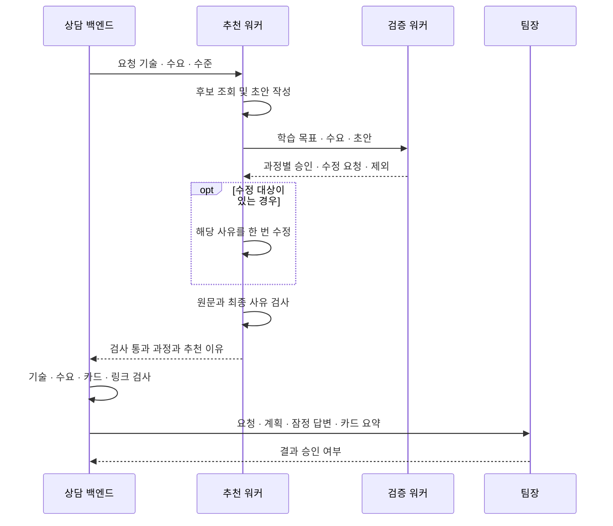

# 구조 3 · 팀장형 학습 상담

구조 3은 사용자의 말을 해석하는 **채팅 에이전트**, 강의를 찾고 추천 이유를 작성하는 **추천 워커**, 그 이유를 학습 목표와 대조하는 **검증 워커**, 상담 전체가 요청에 맞는지 판단하는 **팀장**으로 구성된다. 이들은 한 상담 안에서 백엔드가 순서대로 호출하는 역할이다. 실제 모드에서는 역할별 프롬프트로 Bedrock 모델을 호출하고, 세션 관리·Gap 계산·도구 실행·카드 표시는 코드가 맡는다.

팀장을 둔 목적은 두 가지 오류를 잡을 수 있는지 확인하는 데 있다. 과정 자체의 추천 이유가 정확해도, “배우고 싶다”를 “이미 할 줄 안다”로 읽거나 사용자가 요청한 Kubernetes 대신 다른 기술의 과정을 보여주면 상담은 실패한다. 팀장은 **실행 전에는 발화와 해석**을, **분석 후에는 요청과 실제 답변**을 대조한다. [팀장 프롬프트와 판정 코드](../ai/supervisor.py)

## 한 메시지가 답변이 되기까지



가드레일이 입력을 차단하거나 검사를 완료할 수 없으면 백엔드가 안내하고 해당 턴을 종료한다. 실제 모드에서 채팅 에이전트는 확인된 사실과 현재 질문을 바탕으로 일반 상담 문장을 작성한다. 기술 요건·개인 Gap·과정 추천에는 지원 직무가 필요하다. 팀장은 이 세 요청의 최종 설명과 카드가 사용자 요청에 맞는지 검토한다. 저장 결과와 오류는 백엔드가 직접 안내한다. [상담 진입점과 요청 분기](../backend/chat.py)

## 채팅 에이전트가 넘기는 상태

| 값 | 유지 범위 | 상담에서 쓰는 방식 |
| --- | --- | --- |
| 보유·정정한 기술과 경험 | 현재 상담의 `Conversation` | “Docker를 썼다”는 경험을 반영하고, “팀원이 한 일이었다”는 정정을 해당 턴부터 적용한다. 사용 경험과 진단 수준은 따로 관리한다. |
| `wishes` | 현재 상담 | “Kubernetes를 배우고 싶다”를 학습 희망으로 보관해 다음 턴의 “아까 배우고 싶다고 한 기술”을 해석한다. |
| `targets` | 이번 실행 계획 | 이번에 강의를 찾을 기술 목록이다. 한 번 강의를 요청한 것만으로 그 기술이 지속적인 학습 희망으로 등록되지는 않는다. |
| `last_gap_skills`, `pending_course_question` | 후속 질문을 해석할 때 | 같은 직무에서 보여준 Gap 순서로 “그중 첫 번째”를 찾는다. 과정 대상을 되물은 뒤에는 “Docker요”라는 답만으로 요청을 이어갈 수 있다. |

실제 모드에서 채팅 에이전트는 사실과 행동을 담은 `turn`, 희망의 추가·철회, `targets`, 과정 요청 범위인 `course_scope`를 제안한다. 팀장의 계획 검토를 거쳐 백엔드에 전달되는 `SupervisedTurn`에는 `turn`, 갱신한 `wishes`, `targets`, 확인 질문 `question`, 결정 순서 `decisions`가 담긴다. [실제 필드가 담긴 계획 예시](../data/sample/supervised_turn.json)

백엔드는 모델 문맥에 최근 사용자·답변 메시지 최대 8개를 전달한다. 기술 정정과 학습 희망은 별도 상태라서 원문이 문맥 범위를 벗어난 뒤에도 상담 중에 참조할 수 있다. 로그인한 사용자가 저장을 요청하면 백엔드가 이번에 지정한 직무·기술·경험을 확인해 프로필에 반영한다. [상담 상태와 프로필 저장](../backend/chat.py)

## 팀장이 계획을 승인하는 기준

팀장은 사용자 원문과 이전 문맥을 읽고 채팅 에이전트의 해석과 비교한다. 누구의 경험인지, 정정이 반영됐는지, 사용자가 요청한 것이 Gap인지 강의인지, 저장 대상과 과정 대상이 발화에 근거하는지가 판단 기준이다.

| 결정 | 다음 동작 |
| --- | --- |
| `continue` | 백엔드가 승인된 계획을 실행한다. 코드가 특정 대상을 가리키는 표현을 감지했는데 계획은 일반 Gap 추천으로 해석했다면, 어느 기술인지 먼저 되묻는다. |
| `reinterpret` | 팀장이 문제 종류와 사용자가 실제로 말한 근거 구절을 돌려준다. 채팅 에이전트가 한 번 다시 해석하고 팀장이 새 계획을 검토한다. 두 번째에도 재해석이 필요하면 질문으로 전환한다. |
| `clarify` | 백엔드가 문제에 맞는 확인 질문을 보여 주고 다음 발화를 기다린다. 예를 들어 Linux와 Docker를 함께 언급한 뒤 “그 기술 하나”라고 하면 어느 쪽인지 묻는다. |

확정된 기술·경험·희망은 작업 실행 전에 세션에 반영된다. 이후 팀장이 작업 결과를 거절하더라도 사용자가 이미 정정한 사실은 다음 턴에 유지된다. [계획 검토](../ai/supervisor.py) · [세션 반영과 결과 처리](../backend/chat.py)

정상 턴은 발화 해석과 계획 검토로 시작한다. 저장 요청 없이 경험을 말하거나 학습 개념을 물으면 이어서 모델이 상담 답변을 한 번 작성한다. 기술 요건이나 개인 Gap을 물으면 백엔드가 조회한 결과를 팀장이 한 번 검토한다. 과정 추천에서는 대상 기술별 추천 사유를 작성하고 검토하며, 캐시 적중, 후보 유무, 수정 요청에 따라 총호출 수가 달라진다. [상담 답변 작성](../ai/chat_reply.py) · [계획·결과 검토](../ai/supervisor.py)

## 추천 이유를 검증하는 과정

아래는 **실제 모드에서 특정 기술을 요청했고, 새로 조회한 후보가 있는 경우**다. 과정별 검증과 팀장의 최종 검토는 서로 다른 질문에 답한다.



- **어떤 기술을 검색하는가.** “Kubernetes 과정”처럼 대상이 정해지면 개인 Gap에 포함되지 않아도 그 기술을 조회한다. “부족한 기술에 맞는 과정”이면 개인 Gap에서 비교 가능한 상위 부족 기술을 고른다. 한 요청에서 최대 기술 3개를 조회한다. 진단 수준이 미입력이거나 정정과 충돌하면 수준에 따른 추천을 보류한다. 이용자가 과정 난이도를 직접 지정하면 그 단계로 검색하며, 직전 추천에 대한 상대 난이도는 기술별로 화면에 표시한 카드에서 결정한다. [요청 기술별 처리](../backend/supervised_courses.py) · [개인 Gap과 추천 API](../backend/api.py)
- **무엇으로 이유를 뒷받침하는가.** 백엔드는 공통 추천 API에 대상 기술을 `review=True`로 전달한다. 추천 워커가 후보의 학습 목표를 근거로 초안을 쓰면 검증 워커는 이를 승인하거나, 수정 근거를 지정하거나, 후보를 제외한다. 코드는 인용한 목표가 해당 과정의 원문에 실제로 있는지 확인한다. 특정 기술을 요청했는데 직무 수요를 확인할 수 없으면 내부 추천의 `demand`는 `null`이며, 사유에는 확인된 학습 목표만 사용한다. 상담에는 수요 자료가 없음을 안내한다. [추천 생성](../ai/recommend.py) · [근거 검증](../ai/recommend_review.py)
- **무엇을 사용자에게 보여주는가.** 백엔드는 대상 기술과 카드 필드를 먼저 검사한다. 팀장은 사용자 원문·계획·표시할 답변과 카드의 기술명·과정명·이유·매칭 상태를 보고 `approved`를 반환한다. 승인된 문장과 검증된 카드를 표시한다. 일부 기술만 실패한 경우 성공한 카드와 실패 안내를 함께 승인할 수 있다. 결과를 거절하거나 판정을 완료할 수 없으면 카드 없이 확인 질문 또는 오류 안내를 반환한다. [결과 판정](../ai/supervisor.py) · [화면 응답 조립](../backend/chat.py)

## 두 턴으로 보는 예시

| 사용자 발화 | 상태와 작업 | 화면 결과 |
| --- | --- | --- |
| “Docker는 써봤고 Kubernetes는 배우고 싶어. 클라우드 엔지니어 준비하려면 뭐가 부족해?” | 보유 기술에 Docker, 학습 희망에 Kubernetes를 둔다. 요청은 `gap`이므로 클라우드 엔지니어 기준 개인 Gap만 조회한다. | 부족 역량을 보여준다. Docker의 수준을 입력한 적이 없으면 ‘수준 미입력’으로 안내한다. |
| “그럼 아까 배우고 싶다고 한 기술의 강의부터 보여줘.” | 이전 `wishes`를 참조해 `targets=["Kubernetes"]`인 `courses` 요청을 만든다. Kubernetes 한 기술에 대해서만 추천·검증을 실행한다. | 결과가 승인되면 Kubernetes 과정의 검증된 이유와 링크를 보여준다. |

이 예시는 모의 모드에서 실제 상담 진입점을 거치는 회귀 테스트로 재현할 수 있다. 첫 턴에는 추천 API 호출이 없고, 둘째 턴의 모든 카드가 Kubernetes에 연결되는지 검사한다. [두 턴 통합 테스트](../backend/test_supervised_chat.py)

## 실행과 비교 평가

저장소 루트에서 아래 명령을 실행하면 3번 상담을 모의 모드로 열 수 있다. 기존 `--supervised` 실행 인자도 같은 구조를 선택한다. 3번 단독 실행에서는 모델을 고정하고 채팅 A/B 투표를 끈다. 모의 모드는 채팅 해석과 계획 검토를 로컬 규칙으로 수행하고, 과정 카탈로그의 학습 목표와 코드 검사로 결과를 만든다. [실행 설정](../app/README.md#팀장-에이전트-상담-실행)

```bash
AB_STRUCTURES=3 BEDROCK_MOCK=1 uv run --python 3.11 --with-requirements requirements.txt streamlit run app/main.py
```

3번만 다중 턴 평가하려면 다음 명령을 사용한다. `--method 3`을 생략하면 같은 문항을 1번과 3번에서 각각 실행한다. 1번 실행에 사용하는 팀원 코드의 커밋과 준비 방법은 실행 설정에 있다.

```bash
BEDROCK_MOCK=1 uv run --python 3.11 --with-requirements requirements.txt python -m ai.eval.supervised_compare --method 3 --case wish-reference
```

2026-11-20 첫 Bedrock 실측에서 3번은 Terraform과 Kubernetes를 각각 요청 대상으로 골랐지만, 두 추천 모두 워커 실패로 최종 카드가 0개였다. 당시 실측은 예시 수요와 로컬 과정 검색을 고정한 개발 문항 두 건이다. 팀장의 기여를 판단하려면 요청 기술을 맞혔는지와 검증된 과정이 실제 사용자에게 전달됐는지를 별도 지표로 읽어야 한다. [실측 조건·결과·한계](../ai/eval/supervised_chat_pilot.md)
