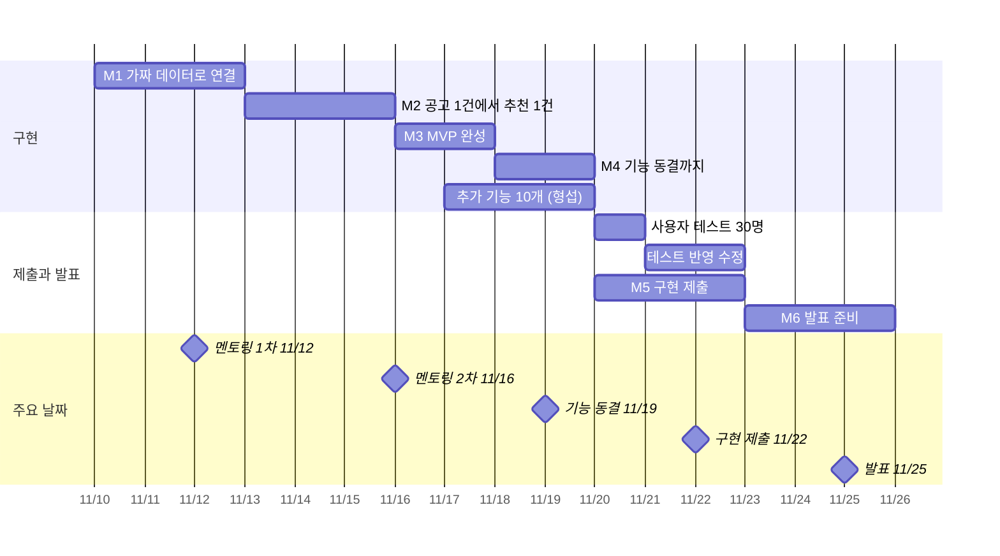

# WBS (작업 분해 구조)

2026-11-17 기준(11/16 기획 결정 반영, 팀 확인 전). **진행 상태와 날짜의 원본은 GitHub Projects 보드입니다.** 이 문서는 마일스톤별로 어떤 작업이 있는지 구조만 보여줍니다.
상태(할 일, 진행 중, 완료)는 여기에 적지 않습니다. 두 곳에 적으면 어긋납니다.

## 어디서 보고 어떻게 고치나

| 보고 싶은 것 | 보드의 뷰 | 고치는 방법 |
| --- | --- | --- |
| 일정 막대(간트) | [로드맵](https://github.com/orgs/Sungsim-Metro/projects/2/views/4) | 막대를 끌거나 시작일·기한 칸을 눌러 날짜 선택 |
| 작업 표 | [WBS 표](https://github.com/orgs/Sungsim-Metro/projects/2/views/5) | 담당, 상태, 시작일, 기한 칸을 눌러 수정 |
| 진행 상태 | [마일스톤 별](https://github.com/orgs/Sungsim-Metro/projects/2/views/2) | 카드를 옆 칸으로 끌어 옮김 |
| 내 할 일 | [담당자 별](https://github.com/orgs/Sungsim-Metro/projects/2/views/3) | 위와 같음 |

- 팀원 네 명 모두 보드 편집 권한(Write)이 있습니다.
- 새 작업은 저장소에서 이슈를 만들면 보드에 자동으로 올라옵니다. 마일스톤과 담당자를 지정하고, 보드에서 시작일과 기한을 채웁니다.
- 끝난 작업은 PR 본문에 `Closes #이슈번호`를 적어 병합하면 이슈가 닫히고 보드에서 완료로 바뀝니다.
- 보드는 조직 구성원만 볼 수 있습니다. 저장소를 공개해도 보드는 따로 공개해야 밖에서 보입니다.

## 전체 일정

## 마일스톤별 작업

### M1 가짜 데이터로 연결 (11/10~11/12)

완료 기준: 가짜 데이터로 화면까지 연결

| 이슈 | 작업 | 담당 |
| --- | --- | --- |
| [#2](https://github.com/Sungsim-Metro/skillpath-ai/issues/2) | 가짜 JSON으로 Streamlit 화면 3개 (입력, 수요·Gap, 추천) | 형섭 |
| [#3](https://github.com/Sungsim-Metro/skillpath-ai/issues/3) | GitHub Projects 보드와 Claude 코드 리뷰 설치 | 형섭 |
| [#4](https://github.com/Sungsim-Metro/skillpath-ai/issues/4) | AWS 팀 계정 점검: IAM, 예산 알림, Bedrock 모델 접근 | 일현 |
| [#5](https://github.com/Sungsim-Metro/skillpath-ai/issues/5) | S3 버킷 구조와 DynamoDB 테이블 설계 | 일현 |
| [#6](https://github.com/Sungsim-Metro/skillpath-ai/issues/6) | 채용공고 데이터 소스 결정과 10건 수집 | 종훈 |
| [#7](https://github.com/Sungsim-Metro/skillpath-ai/issues/7) | AWS 교육과정 목록 CSV 정리 | 종훈 |
| [#8](https://github.com/Sungsim-Metro/skillpath-ai/issues/8) | 추출 정답지 10건 작성 | 성진 |
| [#9](https://github.com/Sungsim-Metro/skillpath-ai/issues/9) | 추출 프롬프트 v1을 Bedrock에서 실행 | 성진 |
| [#40](https://github.com/Sungsim-Metro/skillpath-ai/issues/40) | 확인 필요: 제출 필수 항목, AWS 과제 기준 배점, 5·6주차 교안 | 형섭 |

### M2 공고 1건 → 추천 1건 (11/13~11/15)

완료 기준: 실제 공고 1건이 추출, 표준화, 추천을 거쳐 화면에 나옴

| 이슈 | 작업 | 담당 |
| --- | --- | --- |
| [#10](https://github.com/Sungsim-Metro/skillpath-ai/issues/10) | 화면을 실제 함수·API에 연결, 근거 문장 표시 | 형섭 |
| [#11](https://github.com/Sungsim-Metro/skillpath-ai/issues/11) | 추출 Lambda와 결과 저장 | 일현 |
| [#12](https://github.com/Sungsim-Metro/skillpath-ai/issues/12) | 수요 집계와 Gap 계산 함수 | 일현 |
| [#13](https://github.com/Sungsim-Metro/skillpath-ai/issues/13) | 기술 별칭 사전 (표현 표준화) | 종훈 |
| [#14](https://github.com/Sungsim-Metro/skillpath-ai/issues/14) | 교육과정 검색 `search_courses(skill)` | 종훈 |
| [#15](https://github.com/Sungsim-Metro/skillpath-ai/issues/15) | 추천 이유 생성 프롬프트 | 성진 |
| [#16](https://github.com/Sungsim-Metro/skillpath-ai/issues/16) | 근거 문장 검증 코드 | 성진 |
| [#42](https://github.com/Sungsim-Metro/skillpath-ai/issues/42) | 역량 분류 체계 확정 (8개 영역, 31개 세부 능력) | 전원 |

### M3 MVP 완성 (11/16~11/17)

완료 기준: 공고 30건 이상, 보유 기술 → Gap → 추천

| 이슈 | 작업 | 담당 |
| --- | --- | --- |
| [#17](https://github.com/Sungsim-Metro/skillpath-ai/issues/17) | 보유 기술 입력과 Gap 화면, 멘토링 시연 준비 | 형섭 |
| [#18](https://github.com/Sungsim-Metro/skillpath-ai/issues/18) | 공고 30~50건 일괄 처리와 엔드포인트 정리 | 일현 |
| [#19](https://github.com/Sungsim-Metro/skillpath-ai/issues/19) | 공고 30~50건 적재 | 종훈 |
| [#20](https://github.com/Sungsim-Metro/skillpath-ai/issues/20) | NCS 능력단위 매핑 데이터 | 종훈 |
| [#21](https://github.com/Sungsim-Metro/skillpath-ai/issues/21) | 추출 정확도 측정 | 성진 |

### M4 기능 동결 (11/18~11/19)

완료 기준: Bedrock Agent, Guardrails·편향 점검, E2E 테스트, 화면 디자인. 이후에는 버그 수정만

| 이슈 | 작업 | 담당 |
| --- | --- | --- |
| [#22](https://github.com/Sungsim-Metro/skillpath-ai/issues/22) | 시연 시나리오 확정과 화면 다듬기 | 형섭 |
| [#23](https://github.com/Sungsim-Metro/skillpath-ai/issues/23) | 시연 환경 고정과 오류 처리 | 일현 |
| [#24](https://github.com/Sungsim-Metro/skillpath-ai/issues/24) | 불확실 표시 기준과 가드레일 | 성진 |
| [#25](https://github.com/Sungsim-Metro/skillpath-ai/issues/25) | Bedrock Agent 대화 ("무엇부터 공부할까?") | 성진 |
| [#26](https://github.com/Sungsim-Metro/skillpath-ai/issues/26) | 학습 순서 제안 표시 | 형섭 |
| [#38](https://github.com/Sungsim-Metro/skillpath-ai/issues/38) | E2E 자동 테스트: 공고 1건 → 추천 | 형섭 |

#### 11/16 결정으로 더한 작업 (11/17~11/19 오후, 팀 확인 전)

구현은 형섭이 먼저 하고 팀원이 PR별로 검토한다. 지침과 완료 조건은 [`sprint-2026-11-17.md`](sprint-2026-11-17.md)에 있다. 이슈는 아직 만들지 않았고 PR 번호를 적었다.

| 순서 | 브랜치 | 작업 | 구현 | 검토(안) |
| --- | --- | --- | --- | --- |
| 0 | `refactor/app-tabs` ([#89](https://github.com/Sungsim-Metro/skillpath-ai/pull/89)) | 화면 파일을 탭별로 나눔 | 형섭 | 형섭 |
| 1 | `feat/skill-level` ([#90](https://github.com/Sungsim-Metro/skillpath-ai/pull/90)) | 보유 수준 3단계 입력 (인터페이스 변경) | 형섭 | 일현 |
| 2 | `feat/radar-chart` ([#91](https://github.com/Sungsim-Metro/skillpath-ai/pull/91)) | 영역 레이더 차트 | 형섭 | 일현 |
| 3 | `feat/recommend-evidence` ([#92](https://github.com/Sungsim-Metro/skillpath-ai/pull/92)) | 추천 카드의 신뢰 근거 | 형섭 | 성진 |
| 4 | `feat/recommend-debate` ([#93](https://github.com/Sungsim-Metro/skillpath-ai/pull/93)) | 추천 에이전트 대 검증 에이전트 | 형섭 | 성진 |
| 5 | `feat/eval-judge` ([#94](https://github.com/Sungsim-Metro/skillpath-ai/pull/94)) | LLM 채점, 사람 재채점, 정답셋 | 형섭 | 성진 |
| 6 | `feat/mentor-connect` ([#95](https://github.com/Sungsim-Metro/skillpath-ai/pull/95)) | 현직자 연결 카드 | 형섭 | 종훈 |
| 7 | `feat/mobile-layout` ([#99](https://github.com/Sungsim-Metro/skillpath-ai/pull/99)) | 폰 화면 폭 맞춤 | 형섭 | 종훈 |
| 8 | `feat/usage-dashboard` ([#96](https://github.com/Sungsim-Metro/skillpath-ai/pull/96)) | 토큰·비용 화면 | 형섭 | 일현 |
| 9 | `feat/search-compare` ([#97](https://github.com/Sungsim-Metro/skillpath-ai/pull/97)) | 과정 검색 방식 비교표 | 형섭 | 종훈 |
| 10 | `feat/report-download` ([#98](https://github.com/Sungsim-Metro/skillpath-ai/pull/98)) | 진단 보고서 내려받기 | 형섭 | 일현 |
| | | 사용자 테스트용 배포 주소 | 미정 | |

### M5 구현 제출 (11/20~11/22)

완료 기준: 11/20 사용자 테스트, 11/21~22 정오 테스트 반영 수정, 제출물 취합과 제출. 팀 내부 마감 18시

| 이슈 | 작업 | 담당 |
| --- | --- | --- |
| [#27](https://github.com/Sungsim-Metro/skillpath-ai/issues/27) | 아키텍처 다이어그램과 README 완성, 시연 영상 촬영 | 일현 |
| [#28](https://github.com/Sungsim-Metro/skillpath-ai/issues/28) | 보고서: 데이터 절 | 종훈 |
| [#29](https://github.com/Sungsim-Metro/skillpath-ai/issues/29) | 보고서: AI·평가 절 | 성진 |
| [#30](https://github.com/Sungsim-Metro/skillpath-ai/issues/30) | 제출물 취합과 제출 | 형섭 |
| [#39](https://github.com/Sungsim-Metro/skillpath-ai/issues/39) | 사용자 테스트: 약 30명 설문(11/20) + 3~5명 관찰 | 형섭 |
| [#44](https://github.com/Sungsim-Metro/skillpath-ai/issues/44) | 저장소 공개 전 체크리스트 (제출 직전 public 전환) | 형섭 |

### M6 발표 (11/23~11/25)

완료 기준: 발표자료와 리허설 2회, 11/25 발표

| 이슈 | 작업 | 담당 |
| --- | --- | --- |
| [#31](https://github.com/Sungsim-Metro/skillpath-ai/issues/31) | 발표자료와 리허설 | 형섭 |

## 담당별 영역

| 담당 | 영역 | 폴더 |
| --- | --- | --- |
| 형섭 | 팀장, PM, 화면, 통합, 발표 | `app/`, `docs/` |
| 일현 | AWS 백엔드: Lambda, DynamoDB, 집계·Gap | `backend/` |
| 종훈 | 데이터·검색: 수집, 전처리, 별칭 사전, 임베딩, Knowledge Base | `pipeline/` |
| 성진 | AI: 추출·추천 프롬프트, Bedrock Agent, Guardrails, 정확도 평가 | `ai/` |
